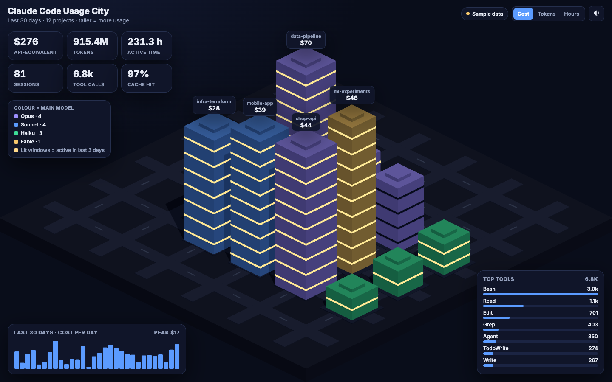
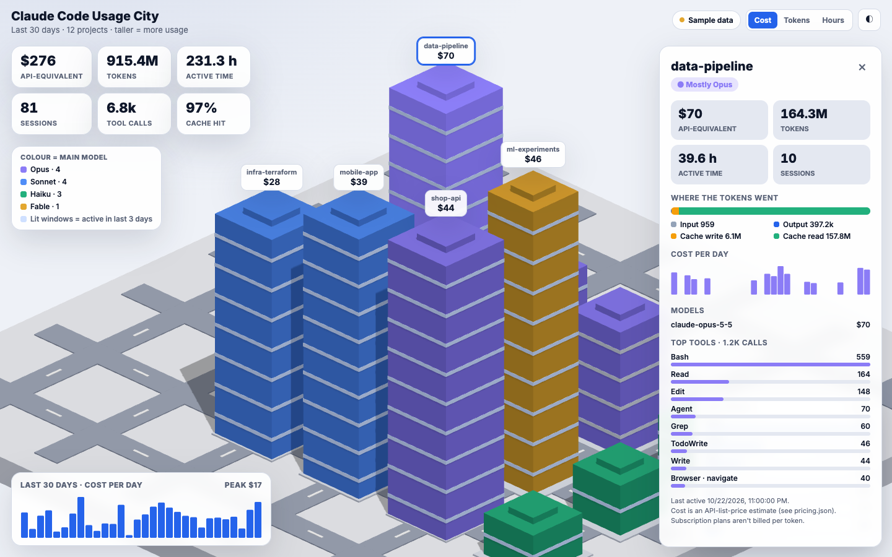

# Claude Code Usage City

See where your Claude Code time and tokens actually go: as a 3D city. Every project is a building.
Taller means more usage (switch between **cost**, **tokens** and **active hours**), colour shows the main
model, and lit windows mean you worked on it in the last 3 days. Click a building for the breakdown.

**[▶ Live demo](https://sanjaydep1996.github.io/claude-code-usage-city/)** (sample data)




## Run it on your own usage

```bash
git clone https://github.com/sanjaydep1996/claude-code-usage-city.git
cd claude-code-usage-city
python3 collect.py            # reads ~/.claude/projects, writes data/usage.json
python3 -m http.server 8000   # then open http://localhost:8000
```

No dependencies: Python 3 standard library and one HTML file (Three.js from a CDN).
Without your own `data/usage.json`, the page shows the made-up sample data. Add `?sample` to the URL to see
the sample even when you have your own.

| Option | What it does |
| --- | --- |
| `--days 90` | Look back 90 days instead of 30 |
| `--anonymize` | Replace project names with "Project A", "Project B"... (use this before sharing a screenshot) |
| `--root PATH` | Read session files from somewhere else |

## What you see

- **KPIs** - API-equivalent cost, total tokens, active time, sessions, tool calls, cache hit rate
- **Per project** - tokens split into input / output / cache write / cache read, cost per day, models, top tools
- **Cost per day** for the whole period, and your **top tools** (MCP tools are grouped by server)

## Privacy

`collect.py` runs only on your machine and sends nothing anywhere. It keeps **totals only**: token counts,
tool names, model names, dates and the project folder name. It never copies prompts, replies, code or file
contents. `data/usage.json` is in `.gitignore` so your real numbers don't get committed by accident.

## How the numbers are worked out

- **Tokens and cost** come from the `usage` block Claude Code records for every response. A response that
  spans several lines (one per content block), or shows up again in a forked session, is counted once.
- **Cost is an estimate at API list prices** from [`pricing.json`](pricing.json) (as of 2026-10-06; edit it
  if prices change). On a Pro, Max, Team or Enterprise plan you aren't billed per token, so read it as
  "what this usage would cost on the API".
- **Active time** adds up the gaps between events in a session, ignoring any gap over 5 minutes.

## Licence

[MIT](LICENSE)
